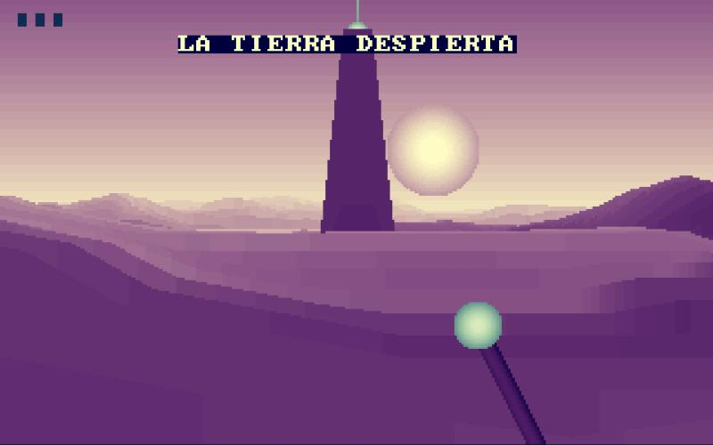
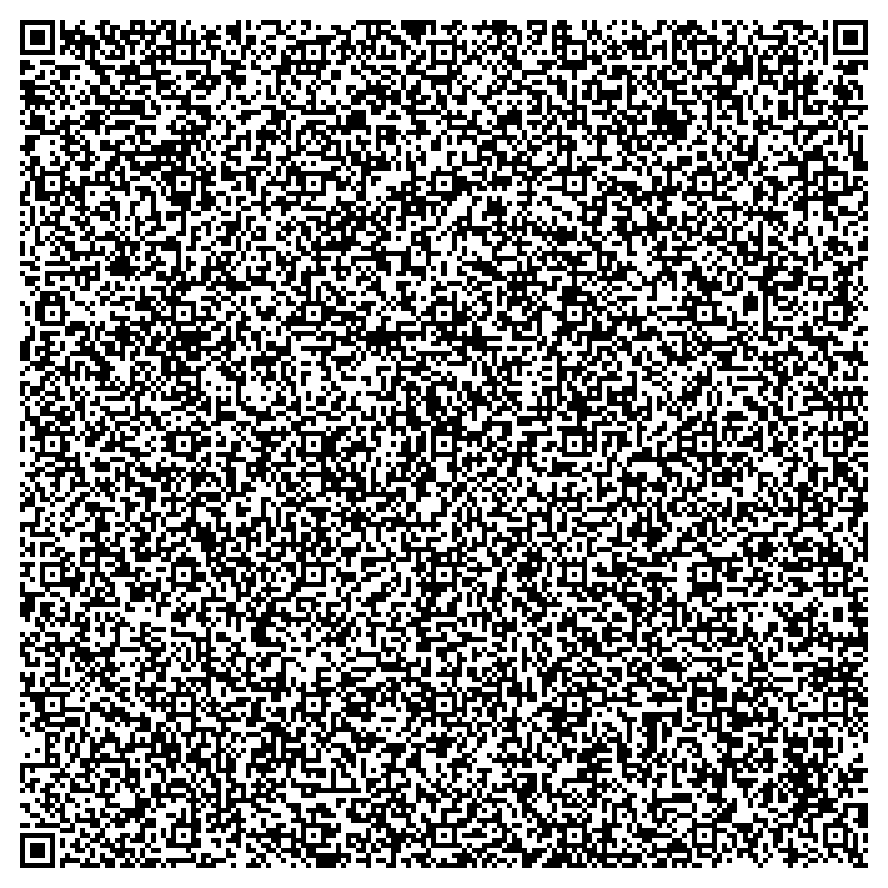
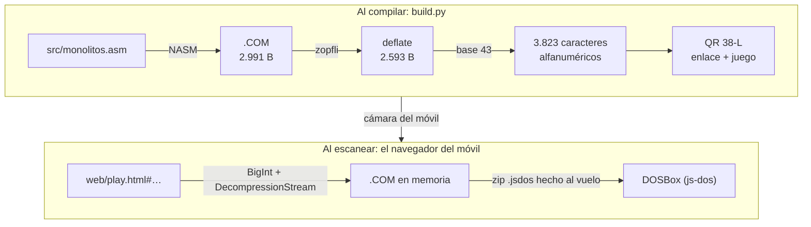

<div align="center">

# Monolitos

**Un mundo abierto en primera persona que cabe entero dentro de un código QR.**

Escaneas el QR con el móvil, se abre el enlace y estás jugando.<br>
Sin servidor de juego, sin descargas: el programa viaja comprimido en la propia URL.




### [▶ Jugar en el navegador](https://edu-martin-perales.github.io/monolitos-3kb-qr/) · o escanea el QR:



</div>

---

## Índice

- [Qué es](#qué-es)
- [El juego](#el-juego)
- [Cómo llega del QR a la pantalla](#cómo-llega-del-qr-a-la-pantalla)
- [Dentro del binario](#dentro-del-binario)
  - [Mapa de memoria](#mapa-de-memoria)
  - [Generación del mundo](#generación-del-mundo)
  - [Render del terreno](#render-del-terreno)
  - [Luz, color y niebla](#luz-color-y-niebla)
  - [Objetos: esferas con z-buffer](#objetos-esferas-con-z-buffer)
  - [Tiempo, entrada y sonido](#tiempo-entrada-y-sonido)
  - [Lógica del juego](#lógica-del-juego)
- [Trucos para ahorrar bytes](#trucos-para-ahorrar-bytes)
- [En qué se gastan los bytes](#en-qué-se-gastan-los-bytes)
- [El QR: compresión y codificación](#el-qr-compresión-y-codificación)
- [La consola web](#la-consola-web)
- [Compilar y probar](#compilar-y-probar)
- [Estructura del repositorio](#estructura-del-repositorio)

---

## Qué es

Monolitos es un programa `.COM` de MS-DOS escrito a mano en ensamblador x86 (modo real de 16 bits,
con instrucciones de 386 y FPU). Genera un paisaje distinto en cada partida, lo pinta en primera
persona trazando un rayo por cada columna de pantalla, tiene enemigos, objetos, sonido y ciclo de
día y noche, y ocupa **2.991 bytes**.

Comprimido son **2.593 bytes**. Codificados en el alfabeto del QR caben, junto con el enlace a la
consola web, en un **QR versión 38 con corrección L** (177 × 177 módulos con su margen; unos 9 cm
impreso a 0,5 mm por módulo). Al escanearlo se abre `web/play.html`, que descomprime el juego en el
navegador y lo ejecuta en DOSBox (js-dos), con cruceta táctil en el móvil.

## El juego

Despiertas al atardecer en una tierra antigua. Hay cuatro plataformas de piedra, marcadas por haces
de luz, y el sol se está poniendo.

| | |
|---|---|
| **Objetivo** | Reúne **3 runas** (orbes cian) y llévalas a una plataforma: su monolito se alza. Alza los **4** antes de que caiga la noche y la tierra despierta |
| **El sol** | Baja con el tiempo y es tu reloj: el mundo se oscurece y salen las estrellas. Si llega la noche, esa tierra se pierde y nace otra. Cada monolito alzado lo sube |
| **Báculo de luz** | Dispara un orbe que sigue tu mirada, con retroceso y un cristal que late |
| **Sombras guardianas** | Rondan las plataformas dormidas, tienen aura y ojos, y se abalanzan si te acercas. Si te tocan, roban sol y esconden una de tus runas en otro lugar |
| **Eclipses** | Orbes de centro oscuro que te persiguen por todo el mundo. Roban el doble de sol. Abatidos dejan una **brasa de sol** que lo hace subir |
| **Monolito alzado** | La tierra tiembla y despierta a su alrededor, aparece una corona de luz y su haz se vuelve **santuario**: deshace a sombras y eclipses que se acercan |
| **Dificultad** | Cada monolito acelera a sombras y eclipses, y suena un arpegio |

**Controles:** flechas o WASD para andar y girar, espacio para lanzar luz, Esc para salir.
En el móvil, cruceta y botón **LUZ** en pantalla. La consola también permite descargar el `.COM`
para ejecutarlo en cualquier DOSBox.

## Cómo llega del QR a la pantalla



El QR no guarda un juego que haya que alojar en ningún sitio: guarda la URL de una página fija y,
detrás del `#`, el juego entero. El fragmento (`#…`) nunca se envía al servidor, así que la página
puede ser estática y servirse desde cualquier sitio (GitHub Pages, una red local…).

## Dentro del binario

### Mapa de memoria

Un `.COM` empieza con un solo segmento de 64 KB, pero el juego reparte su trabajo en cinco, uno
detrás de otro, y dedica cada registro de segmento a lo que más se repite:

| Registro | Segmento | Contenido |
|---|---|---|
| `CS` = `SS` | el del programa | Código, tablas y variables. La **tabla de niebla** (64 × 256) vive en `CS:4000h` |
| `FS` | `CS + 1000h` | **Mapa de alturas** 256 × 256 |
| `GS` | `CS + 2000h` | **Mapa de colores** 256 × 256 |
| `ES` | `CS + 3000h` | **Pantalla oculta** 320 × 200; se copia a la VGA con `rep movsd` tras el retrazado |
| `DS` | `CS + 4000h` | **Profundidad** por píxel (64.000 bytes) y, en la cola: tabla `1/z`, entidades y plataformas |

Las variables se leen como `[bp+desplazamiento]`. Como `SS` = `CS`, `BP` apunta al medio del bloque
de tablas, variables y teclas, de modo que **todo** queda a ±128 bytes y cada acceso lleva un
desplazamiento de un solo byte.

### Generación del mundo

1. **Diamante-cuadrado sobre un toro.** La celda se direcciona con `BX` = `y:x` (un byte cada uno),
   así que el mundo se cierra sobre sí mismo gratis: sumar o restar desborda el byte y da la vuelta.
   Recorrer el mapa entero es `inc bx / jnz`.
2. **Suavizado** con medias de vecinos (tres pasadas en alturas, dos en colores).
3. **Forma:** se centra en la media y se eleva al cuadrado. Los valles quedan llanos y los picos
   se afilan.
4. **Color:** luz rasante (diferencia de altura entre el vecino de la izquierda y el de la derecha)
   más altura. Por debajo del nivel del agua el suelo se aplana y se tiñe: **lagos-espejo**.
5. **Plataformas:** cuatro, repartidas en franjas del mapa, con explanada de 8 × 8 y estrado de 4 × 4.
6. **Semilla:** la hora de DOS. Cada partida, otra tierra.

### Render del terreno

Un rayo por columna de pantalla (320), de cerca a lejos, al estilo *voxel space*:

- La posición del rayo va **empaquetada en `ESI` = `(y << 16) | x`**, en coma fija 8.8. Avanzar es
  una sola suma de 32 bits.
- La altura proyectada usa una **tabla `1/z`** precalculada: ninguna división en el bucle.
- **Paso adaptativo:** de una celda hasta la 64, y luego se duplica a 64, 128 y 192. Son 120
  muestras por columna en vez de 255.
- **Oclusión sin z-buffer para el terreno:** cada columna recuerda la fila más alta ya pintada y solo
  pinta lo que asoma por encima. Si llega arriba del todo, la columna termina.
- **Altura y color bilineales** en las 40 celdas más cercanas, para que el suelo próximo no se vea en
  escalones. El color se puede interpolar porque es un índice dentro de una **rampa** de paleta:
  interpolar el índice es interpolar el color.
- A la vez se escribe la **profundidad** de cada píxel, que luego usan los objetos y las estrellas.

### Luz, color y niebla

- **Paleta por fórmula**, recalculada en cada fotograma:
  - 0–127: rampa de atardecer (rojo lineal, verde cuadrático, azul suave) **escalada por la altura
    del sol**. Al bajar el sol, todo el mundo se oscurece hacia el índigo; de noche queda un suelo
    de luz de luna.
  - 128–255: rampa cian de **luz mágica** que no se apaga de noche (runas, báculo, haces).
  - Los golpes y las brasas suben la luz unos fotogramas: el destello es solo un cambio de paleta.
- **Niebla por tabla** `[z/4][color]`: mezcla cada color de la rampa de atardecer con el del
  horizonte según la distancia. Una lectura por píxel.
- **Cielo** degradado hacia el horizonte y **estrellas** que aparecen según cae el sol, colocadas
  con un hash multiplicativo y que giran con la vista. Solo se pintan donde la profundidad dice
  «cielo».

### Objetos: esferas con z-buffer

Todo lo que no es terreno (runas, sombras, eclipses, brasas, el sol, el báculo, las coronas e
incluso los haces de luz) sale de **una sola rutina de esfera sombreada**:

- **Proyección con la FPU** (rotación y división en coma flotante).
- **Luz sin dividir por píxel:** la intensidad es `(r² − d²) · kq`, con `kq = kk · 65536 / r²`
  calculado una vez por esfera.
- **Prueba de profundidad por píxel** contra el buffer del terreno, y niebla con la misma tabla.
- **Estiramiento vertical:** con un factor de 60, la esfera se convierte en el haz de luz que marca
  cada plataforma.
- **Sombreado invertido** (centro oscuro, halo brillante) para sombras y eclipses, con un `XOR`
  (ver [trucos](#trucos-para-ahorrar-bytes)).

### Tiempo, entrada y sonido

- **Lógica a ritmo fijo.** El PIT se reprograma a **72,8 Hz** (divisor `4000h`) y la interrupción
  `1Ch` cuenta pasos. Cada fotograma ejecuta los pasos pendientes (hasta 8) y luego pinta tan rápido
  como puede: el juego va igual de rápido en un móvil lento que en un PC rápido.
- **Teclado propio** (`int 9`): una tabla de 128 teclas que vale `FFh` mientras están pulsadas.
- **Sonido** por el altavoz del PC (canal 2 del PIT): una nota por runa (cada vez más aguda),
  disparo, golpe, monolito alzándose y un arpegio al completarlo.
- **Texto** con la BIOS (`int 10h`, función `13h`): «LA TIERRA DESPIERTA» y «LA NOCHE CAE».

### Lógica del juego

Las entidades son registros de 8 bytes (posición 8.8, tipo y un dato auxiliar). Las sombras vuelven
a su puesto si te alejas y te persiguen si te acercas; los eclipses te persiguen siempre; cada uno
lleva su propio ritmo para no fundirse con los demás. La distancia es de Chebyshev
(`max(|dx|, |dy|)`), que solo necesita restas y comparaciones. Al caer la noche, el juego regenera
el mundo sin volver a instalar interrupciones ni recalcular las tablas fijas.

## Trucos para ahorrar bytes

En sizecoding cada byte cuenta, y aquí cuenta dos veces: en el binario y en lo que comprime.
Estos son los recursos que más rinden:

| Truco | Cómo funciona |
|---|---|
| **Todo a un byte de `BP`** | Tablas, variables y teclas se colocan alrededor de `BP`, así que cada acceso es `[bp+d8]` (3 bytes) en vez de una dirección absoluta (4–5 bytes) |
| **Bucles que acaban al desbordar** | Las plataformas están al final del segmento (`FFE0h`): recorrerlas es `add si,8 / jnz`, sin comparación |
| **El tipo como aritmética** | Brasa 1, runa 2, sombra 3, eclipse 4… Abatir a un enemigo es `shr byte [si+4],2`: la sombra pasa a 0 (desaparece) y el eclipse a 1 (deja su brasa) |
| **Datos en la dirección** | Las entidades están alineadas a 128 bytes, así que los bits del puntero `SI` de cada sombra ya dicen a qué plataforma pertenece y en qué vértice de su triángulo de guardia está |
| **Sombreado invertido con `XOR`** | `color = base + (luz XOR inv)`. Con `inv = FFh` y `base = base + kk + 1` sale exactamente `base + kk − luz`, sin saltos |
| **Una rutina para enganchar y soltar** | `swap` intercambia los vectores de `int 9` e `int 1Ch` con los guardados y alterna el PIT entre 72,8 y 18,2 Hz. Llamarla dos veces deja todo como estaba |
| **Teclado con `salc`** | `cmp al,80h / salc` convierte el bit de «soltada» del código de tecla en `FFh`/`00h` en dos bytes |
| **Salir con `ret`** | DOS deja un 0 en la pila de un `.COM`; `ret` salta a `PSP:0`, donde hay un `int 20h` |
| **Media sin desbordar** | `add al,[…] / rcr al,1` promedia dos bytes conservando el noveno bit en el acarreo |
| **Coordenadas que dan la vuelta solas** | `BX` = `y:x` en bytes: el mundo es un toro sin una sola instrucción de módulo |
| **Rutinas compartidas y llamadas de cola** | Una sola rutina coloca cualquier objeto en tierra al azar y otra revive sombras y eclipses; los manejadores terminan en `jmp` en vez de `call` + `ret` |
| **Pares de variables contiguas** | `camx`/`camy`, `tx`/`ty`, `base`/`kk`, `strc`/`invk`: se leen o escriben de dos en dos con una sola instrucción de 16 o 32 bits |
| **Canal del altavoz configurado una vez** | El modo del canal 2 se fija al arrancar; cada pitido solo escribe el divisor |
| **Tablas en vez de código** | Radio, color, rango de luz, altura y sombreado de cada tipo de objeto son cinco tablas de 6 bytes |

## En qué se gastan los bytes

| Parte | Bytes | |
|---|---:|---|
| Lógica (movimiento, plataformas, enemigos, objetos, tiempo) | 874 | `██████████████▋` |
| Objetos (esferas, proyección, haces, estrellas) | 643 | `██████████▊` |
| Render del terreno y del cielo | 410 | `██████▉` |
| Generación del mundo | 407 | `██████▊` |
| Interfaz, paleta, sonido, teclado y volcado a la VGA | 385 | `██████▍` |
| Arranque, interrupciones y tablas precalculadas | 194 | `███▎` |
| Datos (tablas por tipo, textos, constantes) | 78 | `█▎` |
| **Total** | **2.991** | |

## El QR: compresión y codificación

- **Compresión:** deflate crudo con **zopfli** (5.000 iteraciones), que busca la mejor codificación
  posible dentro del mismo formato. `build.py` lo compara con zlib nivel 9 y se queda con el más
  pequeño. El navegador lo descomprime con `DecompressionStream("deflate-raw")`, sin librerías.
- **Base 43 en vez de base 64.** El modo alfanumérico del QR admite 45 símbolos y empaqueta 2 en
  11 bits (5,5 bits por carácter). Quitando el espacio y el `%`, que no son seguros en una URL,
  quedan 43: cada carácter lleva log₂ 43 ≈ 5,43 bits de información, un **98,7 %** de
  aprovechamiento. Base 64 tendría que ir en modo byte (8 bits por carácter para 6 de información):
  un 75 %.
- **Dos segmentos en el mismo QR:** el prefijo de la URL en modo byte (tiene minúsculas) y el juego
  en modo alfanumérico.
- **Un 1 delante.** El juego se convierte en un número enorme y se escribe en base 43; un byte `01`
  al principio evita perder los ceros iniciales.
- **Corrección L.** Para la cámara de un móvil es suficiente, y deja el máximo espacio para datos.
- **Verificación de extremo a extremo:** tras generar el PNG, `build.py` lo lee con un decodificador
  independiente (zxing-cpp), deshace la base 43 y la compresión, y comprueba que sale el `.COM`
  **byte a byte**.

## La consola web

`web/play.html` es una sola página, sin más dependencia que js-dos:

- Lee el fragmento `#…`, lo decodifica de base 43 con `BigInt` y lo descomprime.
- **Construye el paquete `.jsdos` en el navegador:** un zip mínimo sin compresión (cabeceras y
  CRC-32 escritos a mano) con el juego y la configuración de DOSBox.
- **Mando táctil** que genera los mismos eventos que el teclado físico, con captura del puntero para
  que no se queden teclas pulsadas.
- Enlace para **descargar el `.COM`** y ejecutarlo en cualquier DOSBox.

## Compilar y probar

**Requisitos:** Python 3.12 y NASM 2.16.

```sh
# Entorno de Python
uv venv --python 3.12 .venv
uv pip install --python .venv/bin/python segno zxing-cpp pillow zopfli

# NASM, compilado en tools/ (desde las fuentes nasm-2.16.03.tar.xz de nasm.us)
./configure --prefix=$PWD/tools && make && make install
```

**Compilar y generar el QR:**

```sh
.venv/bin/python build.py src/monolitos.asm --url=https://<usuario>.github.io/<repositorio>/web/play.html#
```

```text
Binario:   build/monolitos.com  2991 bytes; comprimido 2593; 3823 caracteres base 43
Margen:    unos 280 bytes comprimidos (~322 de binario)
Enlace:    build/monolitos-url.txt  (3862 caracteres)
QR:        build/monolitos-qr.png  versión 38-L, 177 módulos con margen; a 0,5 mm/módulo mide 8.8 cm
Verificado: el QR se lee y reconstruye el juego byte a byte
```

Sin `--url`, el enlace apunta a `http://<IP local>:8512/web/play.html#`, para probar con el móvil en
la red de casa sirviendo la carpeta:

```sh
.venv/bin/python -m http.server 8512 --bind 0.0.0.0
```

En el ordenador basta con abrir el enlace de `build/monolitos-url.txt`. `--draft` escribe el enlace
aunque el juego no quepa en un QR 40-L, para seguir probando mientras se recorta.

`src/monotest.asm` compila una variante que empieza junto a una plataforma con 3 runas y 3 monolitos
ya alzados, para ver el final sin jugar la partida entera.

**Publicarlo:** activa GitHub Pages en la rama principal y genera el QR con la dirección pública y
`--site`, que copia el QR a `docs/qr.png` y el juego a `docs/juego.txt` para la portada y este README:

```sh
.venv/bin/python build.py src/monolitos.asm --url=https://<usuario>.github.io/<repositorio>/web/play.html# --site
```

## Estructura del repositorio

```text
├── src/
│   ├── monolitos.asm   El juego
│   └── monotest.asm    Variante de prueba (empieza en el final)
├── web/
│   └── play.html       Consola: decodifica el enlace y ejecuta el juego en DOSBox
├── docs/
│   ├── monolitos.png   Captura
│   ├── qr.png          El QR publicado (build.py --site)
│   └── juego.txt       El juego en base 43, para el botón «Jugar» (build.py --site)
├── index.html          Portada de GitHub Pages: captura, QR y botón para jugar
├── build.py            Compila, comprime, genera el QR y lo verifica
└── build/              Salida, no versionada (.com, .lst, -qr.png, -url.txt)
```
